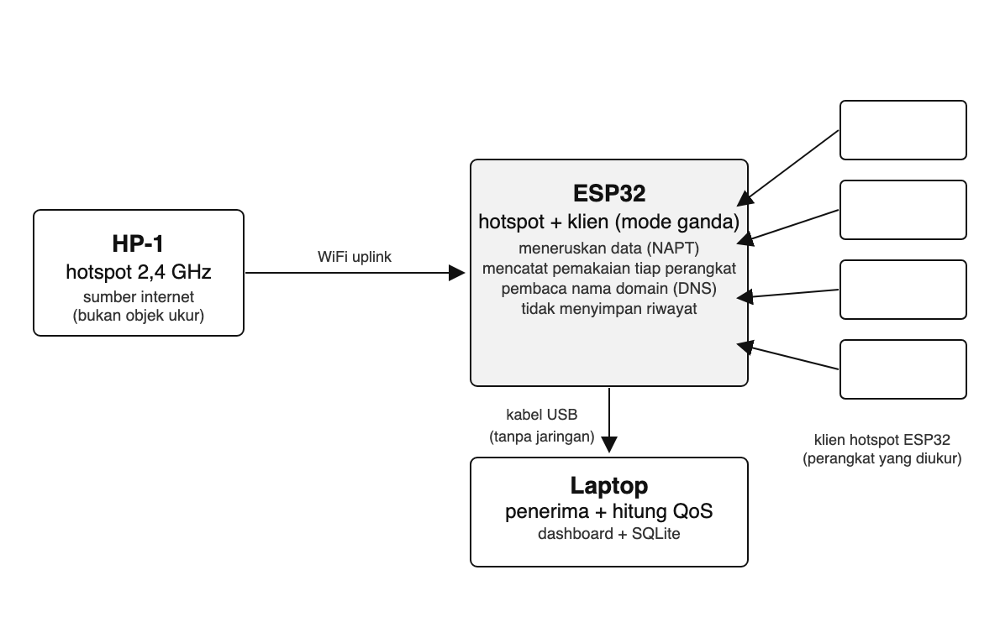

# Rencana Proyek — Gerbang WiFi ESP32 untuk Pemantauan QoS Banyak Perangkat

**Mata kuliah:** Wireless / Mobile Computing (MKKL1029) · Semester 7
**Program Studi Ilmu Komputer — Fakultas Sains, Teknologi dan Ilmu Kesehatan, Universitas Bina Bangsa Getsempena**
**Dosen Pengampu:** Ahmad Mujahid Abdurrahman, S.Kom, M.T.
**Versi:** 2.0 — 28 Oktober 2026 (menggantikan topik *wearable health monitor*)

> Salinan markdown dari proposal yang dikumpulkan. Versi resmi ada di
> `docs/proposal/` — kalau berbeda, yang di `docs/proposal/` yang berlaku.

## 1. Identitas Kelompok

| No | Nama | NIM | Bagian yang dikerjakan |
|---|---|---|---|
| 1 | Paris Mursidan Aufal | 23210125 | Penerima di laptop + basis data SQLite |
| 2 | Yogi Prasetya Sadewa | 23210060 | Ketua kelompok; penghitung QoS + penggabung data per perangkat |
| 3 | M. Sidiq Prasetio | 23210075 | Dashboard web + grafik langsung |
| 4 | Deski Taiza | 23210003 | Firmware mode ganda (hotspot + klien) + NAPT |
| 5 | Wira | 23210045 | Firmware pencatat pemakaian per perangkat + DNS |
| 6 | T. Zain Wardana | 23210001 | Pengujian QoS + laporan |

## 2. Masalah dan Tujuan

### Masalah yang diselesaikan

Satu jaringan WiFi biasanya dipakai banyak perangkat sekaligus, dan ketika semuanya
aktif koneksi terasa melambat. Yang tidak pernah terdengar adalah angkanya: berapa
perangkat yang aktif, berapa pemakaian masing-masing, dan seberapa besar kualitas
jaringan turun ketika jumlah perangkat bertambah. Halaman pengaturan router rumahan
umumnya hanya menampilkan daftar perangkat yang tersambung dan total pemakaian,
bukan rincian per detik untuk tiap perangkat. Kelompok ini membuat alat ukur sederhana
untuk mengisi kekosongan itu.

### Latar belakang

- Keluhan "internetnya lemot" tidak bisa dibuktikan tanpa angka.
- Router murah tidak menyediakan catatan pemakaian per perangkat dalam bentuk yang
  bisa diolah.
- ESP32 sudah tersedia dan harganya murah, sehingga bisa dijadikan gerbang sekaligus
  alat ukur tanpa membeli perangkat baru.

### Pengguna sasaran

- Mahasiswa dan pengguna kos: ingin tahu perangkat mana yang menghabiskan kuota.
- Dosen dan mahasiswa: bahan pembelajaran 802.11, NAT, DNS, dan QoS.

### Batasan lingkup

- Isi trafik terenkripsi (HTTPS/QUIC) tidak dibaca; hanya besar data, jumlah paket,
  dan nama domain dari DNS.
- Identifikasi kegiatan adalah perkiraan dari nama domain, bukan kepastian.
- ESP32 bukan pengganti router: throughput ±1–2 Mbps.
- Maksimal 4 perangkat uji + 1 HP sebagai sumber internet.
- ESP32 tidak menyimpan riwayat; penyimpanan hanya di laptop.
- Pengujian di satu ruangan, satu titik, tanpa uji jarak jauh.

### Tujuan

1. Membuat satu ESP32 yang meneruskan internet ke empat perangkat sekaligus sambil
   mencatat pemakaian tiap perangkat.
2. Mengirim catatan itu ke laptop tanpa jaringan, hanya lewat kabel USB.
3. Menampilkan data perangkat secara langsung pada dashboard.
4. Mengukur pengaruh jumlah perangkat aktif terhadap latency, jitter, packet loss,
   dan throughput.

## 3. Arsitektur Sistem

*Gambar 1. Susunan sistem — empat perangkat klien melewati ESP32, catatan pemakaian dikirim ke laptop lewat kabel USB.*

- HP-1: hotspot 2,4 GHz, sumber internet. Jalur, bukan objek ukur.
- ESP32: klien sekaligus hotspot, ditambah NAPT; mencatat pemakaian per perangkat.
- HP-2 … HP-5: perangkat yang diukur, tersambung ke hotspot ESP32.
- Kabel USB-C: jalur catatan ke laptop, tanpa jaringan.
- Laptop: penerima, penghitung QoS, penyimpanan SQLite, dashboard.

Alur data dan rumus QoS ada pada [`arsitektur.md`](arsitektur.md).

## 4. Alat dan Bahan

| No | Nama alat | Jumlah | Perkiraan harga | Subtotal |
|---|---|---|---|---|
| 1 | ESP32 DevKit V1 | 1 buah | Rp 65.000 | Rp 65.000 |
| 2 | Kabel USB-C ke USB-C | 1 buah | Rp 35.000 | Rp 35.000 |
| 3 | Kabel USB-C ke USB-A (cadangan) | 1 buah | Rp 25.000 | Rp 25.000 |
| 4 | Adaptor daya USB 5V 2A | 1 buah | Rp 30.000 | Rp 30.000 |
| | | | **Total** | **Rp 155.000** |

Laptop, empat telepon genggam, dan telepon genggam sumber internet sudah dimiliki
anggota; ESP32 sudah tersedia dari pengujian sebelumnya. Perangkat lunak: Arduino IDE
dengan dukungan ESP32, Python, SQLite — semuanya gratis.

## 5. Rencana Pencapaian UTS (Pertemuan 8)

| Bagian yang dijanjikan selesai | Bentuk bukti | Penanggung jawab |
|---|---|---|
| Firmware mode ganda + NAPT, ESP32 meneruskan internet ke perangkat uji | Keluaran serial `# uplink ...` dan perangkat uji bisa membuka halaman web | Deski Taiza |
| Catatan `hb`/`ev` terbaca di laptop lewat kabel USB | Tangkapan monitor serial | Deski Taiza, Wira |
| Penerima di laptop membaca catatan serial dan menyimpannya | Berkas CSV/SQLite hasil satu sesi | Paris Mursidan Aufal |
| Dashboard menampilkan jumlah klien dan pemakaian per perangkat | Halaman dashboard yang bisa dibuka | M. Sidiq Prasetio |
| Hasil awal pengukuran S1 dan S3 | Tabel sementara | T. Zain Wardana |
| Repository aktif: README, proposal, riwayat commit | Riwayat commit mingguan | Yogi Prasetya Sadewa |

## 6. Rencana Pencapaian UAS (Pertemuan 16)

### Produk akhir

- ESP32 gerbang berjalan penuh: meneruskan internet, menghitung pemakaian per
  perangkat, mencatat nama domain.
- Dashboard di laptop yang menampilkan pemakaian per perangkat secara langsung.
- Laporan pengukuran S1–S5 beserta tabel dan grafik keempat parameter QoS.
- Pembahasan keterbatasan nirkabel: bagi-bagi bandwidth, batas 4 klien, pita 2,4 GHz
  yang padat, dan pengaruh jarak.

### Skenario demonstrasi

1. Menyalakan sistem dan memperlihatkan empat perangkat mendapat internet lewat ESP32.
2. Memperlihatkan catatan pemakaian tiap perangkat bergerak saat ada kegiatan.
3. Menjalankan S1 → S3 → S4 dan memperlihatkan latency naik serta throughput per
   perangkat turun.
4. Mencabut kabel USB dan memperlihatkan catatan berhenti (bukti ESP32 tidak menyimpan).
5. Mematikan hotspot HP-1 dan memperlihatkan proses sambung ulang.
6. Setiap anggota menjelaskan bagian yang dikerjakannya, dipilih langsung oleh dosen.

## 7. Pembagian Kerja per Minggu

| Minggu | Kegiatan utama | Luaran |
|---|---|---|
| Ke-8 | Finalisasi proposal dan penyusunan ulang repository | Proposal, README, struktur folder |
| Ke-9 | Firmware mode ganda + NAPT diuji dengan perangkat nyata | Perangkat uji mendapat internet lewat ESP32 |
| Ke-10 | Penghitung byte per perangkat dan pembaca nama domain | Baris catatan per perangkat di serial |
| Ke-11 | Penerima serial + penyimpanan SQLite | Berkas hasil satu sesi |
| Ke-12 | Dashboard langsung | Halaman dashboard dengan grafik |
| Ke-13 | Pengukuran S1–S5 | Tabel hasil pengukuran |
| Ke-14 | Uji jarak, penghalang, kanal padat | Tabel hasil tambahan |
| Ke-15 | Pengolahan hasil dan penyusunan laporan | Draf laporan lengkap |
| Ke-16 | Presentasi dan demonstrasi | Laporan akhir dan bahan presentasi |

## 8. Risiko dan Rencana Cadangan

| Risiko | Rencana cadangan |
|---|---|
| NAPT tidak berjalan sehingga perangkat uji tidak dapat internet | Uji lebih awal; bila gagal, pakai firmware contoh ESP32 NAPT resmi atau turunkan target menjadi pengukuran tanpa internet (hanya lalu lintas lokal) |
| Hotspot HP mengisolasi klien atau mematikan diri saat kosong | Matikan mode hemat daya hotspot; sediakan router 2,4 GHz sebagai cadangan |
| Penghitung byte per perangkat tidak tersedia di API Arduino | Hitung di lapisan lwIP atau pakai cermin port (port mirroring) pada router cadangan |
| Angka latency tidak masuk batas karena dibagi empat perangkat | Laporkan apa adanya dan jelaskan sebabnya — bagian dari temuan, bukan kegagalan |
| Anggota tidak aktif sehingga jadwal meleset | Setiap bagian punya penanggung jawab cadangan; ketua melaporkan kondisi pada sesi progres |

## 9. Riwayat Dokumen

- v1.0 — 19 September 2026: rencana topik *wearable health monitor* (tidak dilanjutkan).
- v2.0 — 28 Oktober 2026: topik diganti menjadi pemantauan QoS banyak perangkat dengan
  ESP32 sebagai gerbang; seluruh isi disesuaikan dengan proposal baru.
